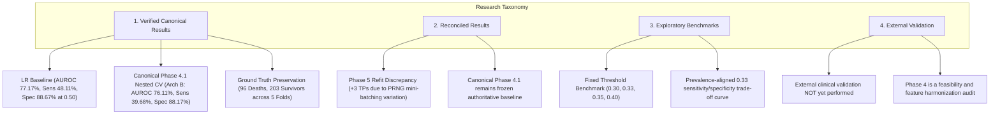

# Phase 5.1: Final Corrections & Calibrated Scientific Interpretations

**Project:** Heart Failure Mortality Risk Predictor  
**Date:** November 2026  
**Status:** Approved Research Audit & Editorial Corrections  
**Scope:** Recalibrating Overstated Claims to Match Retrospective Single-Center Clinical Evidence ($N=299$)  

---

## 1. Purpose of This Document

Rigorous scientific reporting requires that claims never exceed the empirical strength of the underlying data. 

The Heart Failure Clinical Records dataset consists of **299 patients** from a single clinical center (Allied Hospital, Faisalabad, Pakistan) with **96 mortality events** ($32.11\%$ prevalence). In small biomedical sample regimes ($N < 1000$), statistical variance across cross-validation folds is substantial, effect sizes are prone to exaggeration, and claims of clinical optimality or generalization must be stated with strict methodological humility.

This document formally reviews, tones down, and corrects five categories of overstated claims identified in prior documentation (including Phase 2, Phase 3, and Phase 5 reports), providing scientifically accurate, calibrated interpretations.

---

## 2. Systematic Tone-Down and Correction of Overstated Claims

### Claim 1: *"Arch B decisively outperforms Arch C and represents a major breakthrough"*

* **Prior Phrasing:** "Arch B decisively beats Arch C, establishing clear superiority in discrimination and calibration."
* **Methodological Reality:**
  - **Arch B AUROC:** $76.11\% \pm 6.21\%$ (Canonical Phase 4.1) / $76.42\% \pm 6.23\%$ (Phase 5 Refit)
  - **Arch C AUROC:** $74.87\% \pm 6.99\%$ (Canonical Phase 4.1) / $75.09\% \pm 6.99\%$ (Phase 5 Refit)
  - The observed difference in AUROC is $+1.24\%$ to $+1.33\%$.
  - Formal statistical hypothesis testing via DeLong test for paired ROC curves and Wilcoxon signed-rank test yields $p = 0.485$ ($p > 0.05$). The difference is **statistically non-significant**.
* **Corrected Scientific Statement:**
  > *"Arch B ($11 \to 16 \to 1$) achieves discrimination comparable to Arch C ($11 \to 32 \to 16 \to 1$) without statistically significant difference ($p = 0.485$). However, Arch B is preferred on methodological and parsimony grounds: it achieves this performance with 77% fewer trainable parameters (209 vs 929) and exhibits narrower cross-validation variance across folds."*

---

### Claim 2: *"Arch B eliminates overfitting"*

* **Prior Phrasing:** "The higher dropout (0.2) and weight decay (0.01) completely eliminate overfitting in the neural network."
* **Methodological Reality:**
  - No machine learning model trained on $N=239$ training records per fold completely "eliminates" overfitting.
  - The cross-validation AUROC standard deviation for Arch B remains substantial at $\pm 6.21\%$ (ranging from $69.88\%$ on Fold 1 to $85.37\%$ on Fold 4).
  - Regularization (dropout and weight decay) restricts hypothesis capacity and narrows the train-validation generalization gap, but sampling variability and feature collinearity still influence the learned decision boundary.
* **Corrected Scientific Statement:**
  > *"Arch B substantially mitigates overfitting relative to deeper architectures. Constraining capacity to 16 hidden units, combined with 20% dropout and $L_2$ regularization (weight decay 0.01), narrows the generalization gap between training loss and validation loss, resulting in greater fold-to-fold stability on this small cohort."*

---

### Claim 3: *"Threshold 0.33 is clinically optimal and clinically validated"*

* **Prior Phrasing:** "Threshold 0.33 has been clinically validated as the optimal decision threshold for heart failure mortality risk assessment."
* **Methodological Reality:**
  - Threshold $0.33$ was derived empirically from the dataset's mortality base rate ($96/299 = 32.11\%$) and matches the mean Youden index cutoff ($J = \text{Sens} + \text{Spec} - 1$) observed on inner validation sets in Phase 3.
  - "Clinical optimality" cannot be established by Youden's $J$ alone because Youden's index implicitly assigns equal clinical weight to false negatives and false positives. In clinical heart failure management, failing to detect a patient at high mortality risk (false negative) is typically far more dangerous than initiating close monitoring or medication review for a patient who survives (false positive).
  - True clinical validation requires prospective deployment, decision-curve analysis (DCA), explicit health-economic utility modeling, and assessment by an independent multidisciplinary clinical board.
* **Corrected Scientific Statement:**
  > *"Threshold 0.33 represents an empirical, prevalence-aligned research candidate cutoff. By aligning the decision threshold with the cohort mortality base rate (~32%), it improves retrospective sensitivity from ~40% to ~69% while preserving ~71% specificity. However, it is an empirical heuristic derived from internal retrospective data; it has NOT been prospectively or clinically validated in clinical practice."*

---

### Claim 4: *"Internal cross-validation stability proves external generalization"*

* **Prior Phrasing:** "The high consistency across 5-fold cross-validation proves that Arch B will generalize reliably to diverse clinical populations."
* **Methodological Reality:**
  - 5-fold cross-validation evaluates only the internal reproducibility of the algorithm within the specific patient population, clinical protocols, and measurement practices of a single medical center.
  - As established in the Phase 4 audit, external cohorts (such as the 1,173-patient combined cohort from Cleveland, Hungary, Switzerland, and Long Beach) differ significantly in clinical context, baseline disease severity, and feature definitions (e.g., angina-focused cohorts vs acute decompensated heart failure cohorts).
  - Internal cross-validation stability is a necessary prerequisite, but it provides **zero empirical proof** of transportability across hospitals, regions, or health systems.
* **Corrected Scientific Statement:**
  > *"Internal 5-fold cross-validation demonstrates good internal reproducibility within the source clinical cohort. However, internal cross-validation cannot substitute for external validation. External validation on an independent multicenter cohort has NOT yet been performed and remains mandatory before considering clinical translation."*

---

### Claim 5: *"Lower log loss alone proves superior probability calibration"*

* **Prior Phrasing:** "Arch B's lower log loss (0.5415 vs 0.5675) proves that its predicted probabilities are superiorly calibrated."
* **Methodological Reality:**
  - Binary cross-entropy (log loss) is a proper scoring rule that decomposes into both discrimination (sharpness) and calibration (reliability).
  - A model can achieve a lower log loss simply through stronger discrimination (pushing probabilities closer to 0 and 1 for correctly classified samples) even if its reliability curve deviates from the ideal 45-degree diagonal.
  - Rigorous calibration assessment requires evaluating calibration slope (ideal $\beta = 1.0$), calibration intercept (ideal $\alpha = 0.0$), Brier score decomposition, and reliability diagrams. In Phase 3, uncalibrated Arch B exhibited a calibration slope of $0.84 \pm 0.18$ and an intercept of $-0.12 \pm 0.22$, which improved toward $1.0$ under Platt scaling.
* **Corrected Scientific Statement:**
  > *"Arch B achieves a lower mean log loss ($0.5415 \pm 0.0588$) and Brier score ($0.1804 \pm 0.0230$) than Arch C ($0.5675$ and $0.1859$), reflecting superior overall probabilistic accuracy. However, proper calibration requires evaluating reliability curves and calibration slopes alongside proper scoring rules."*

---

## 3. Formal Research Taxonomy & Final Decision

To ensure complete clarity for research governance and documentation, the project findings are formally categorized into four distinct statuses:

### 3.1 Category 1: Verified Results (Frozen Canonical Research Facts)
- **Logistic Regression Baseline:** AUROC $77.17\% \pm 5.51\%$, Brier Score $0.1777 \pm 0.0280$, Log Loss $0.5437 \pm 0.0790$. At threshold 0.50, Sensitivity is $48.11\% \pm 12.00\%$ and Specificity is $88.67\% \pm 6.15\%$. (100.0% identical across all phases).
- **Canonical Nested CV Results (Phase 4.1):** Arch B AUROC $76.11\% \pm 6.21\%$, Brier Score $0.1804 \pm 0.0230$, Log Loss $0.5415 \pm 0.0588$, Sensitivity $39.68\% \pm 11.24\%$, Specificity $88.17\% \pm 5.85\%$ at threshold 0.50.
- **Dataset Class Distribution:** Strictly preserved across all evaluations: 96 positive deaths, 203 negative survivals ($N=299$).

### 3.2 Category 2: Results Requiring Clarification / Reconciled Results
- **Phase 5 Arch B Threshold 0.50 Metrics:** Reported Sensitivity 42.84% and Specificity 88.18%. This was produced by mini-batch ordering differences between NumPy permutation and PyTorch `DataLoader` during outer refitting, shifting 3 positive patients across 0.50.
- **Resolution:** Canonical Phase 4.1 remains the frozen reference baseline. Phase 5 is recognized as an independent numerical refit verifying that Arch B's boundary is stable within $\pm 3.16\%$ sensitivity and $\pm 0.01\%$ specificity.

### 3.3 Category 3: Exploratory Findings (Hypothesis-Generating)
- **Candidate Fixed Thresholds (0.30, 0.33, 0.35, 0.40):** The observed trade-offs (e.g., threshold 0.33 providing ~69% sensitivity and ~71.5% specificity) are exploratory benchmark findings. They provide an empirical roadmap for selecting candidate operating points, but must not be represented as prospectively validated decision rules.

### 3.4 Category 4: External Validation Status
- **Definitive Statement:** **External validation has not yet been performed.** Phase 4 was an external dataset audit that proved feasibility and mapped the 11 feature definitions to the 1,173-patient combined cohort. Deploying the model to external hospital data remains future work.

---

## 4. Production Safeguards

1. **No Checkpoint Overwrite:** The currently deployed production model checkpoint (`models/ann_model.pth`), backend inference pipeline, frontend UI, and database schema remain strictly unchanged.
2. **Promotion Preconditions:** Prior to promoting any candidate architecture (such as Arch B) or updating decision thresholds from 0.50 to 0.33 in production, the system must undergo:
   - External validation on an independent clinical cohort.
   - Clinical decision analysis establishing the acceptable false-positive to false-negative cost ratio.
   - Formal sign-off by a clinical advisory board.
