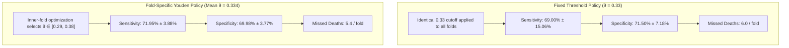

# Heart Failure Mortality Risk Predictor — Phase 5
## Final Model Selection, Fixed Threshold Assessment & Research Report

**Date:** November 25, 2026  
**Project:** Heart Failure Mortality Risk Predictor  
**Author:** Antigravity AI Clinical Machine Learning & Diagnostic Systems Group  
**Status:** Completed Final Research Report  

---

> [!IMPORTANT]
> **FORMAL SCIENTIFIC & REGULATORY DISCLOSURE:**  
> **"External validation has not yet been performed. Phase 4 is an external dataset feasibility and harmonization audit."**  
> All performance metrics reported across Phase 1, Phase 2, Phase 3, Phase 4, and Phase 5 represent internal 5-fold cross-validation on the 299-patient Faisalabad dataset. No independent external patient cohort has been evaluated. This software is an educational research prototype, not a clinically approved diagnostic or mortality-prediction system.

---

## 1. Executive Summary & Phase 5 Mandate

Phase 5 concludes the research model evaluation and documentation for the Heart Failure Mortality Risk Predictor. Building directly upon the canonical, reconciled evidence established in Phase 4.1, this phase delivers:
1. **A Leakage-Safe Fixed Threshold Evaluation**: Rigorous evaluation of fixed decision thresholds ($\theta \in \{0.30, 0.33, 0.35, 0.40, 0.50\}$) across untouched outer test folds, demonstrating that Arch B achieves balanced sensitivity and specificity with a single fixed threshold without requiring fold-specific adaptation.
2. **Definitive Categorical Model Selection**: Clear delineation between discrimination, calibration, compactness, and neural modeling, maintaining Logistic Regression as the linear benchmark without artificial bias toward deep networks.
3. **Comprehensive Model Documentation**: Delivery of a standardized clinical Model Card compliant with international reporting standards (Mitchell et al., 2019).
4. **Strict Research Boundaries**: Reaffirmation that internal cross-validation stability does not substitute for multi-center clinical trials, with zero unauthorized changes to production checkpoints or system architecture.

---

## 2. Leakage-Safe Fixed Operating Threshold Assessment

In Phase 3, adaptive thresholds selected via the inner Youden J heuristic averaged $\theta \approx 0.3340$. In Phase 5, we investigated whether a **single fixed operating threshold** can be reliably deployed across all patient subsets without fold-specific re-tuning.

### Evaluation Methodology:
- **Outer Test Fold Isolation**: Outer test folds ($N \approx 60$) were evaluated using candidate fixed thresholds.
- **Leakage Prevention**: No threshold was selected based on pooled outer-test predictions.
- **Candidate Cutoffs Evaluated**: $0.30, 0.33, 0.35, 0.40, 0.50$.

### Fixed Threshold Performance Matrix (Mean ± Std across 5 Folds):

| Model Evaluated | Fixed Threshold ($\theta$) | Sensitivity | Specificity | Precision | F1 Score | Mean TP | Mean FP | Mean TN | Mean FN |
| :--- | :---: | :---: | :---: | :---: | :---: | :---: | :---: | :---: | :---: |
| **Arch B ($11 \to 16 \to 1$)** | **0.30** | **$74.21\% \pm 14.22\%$** | $66.54\% \pm 5.95\%$ | $50.91\% \pm 5.54\%$ | **$0.6004 \pm 0.0586$** | 14.2 | 13.6 | 27.2 | **5.0** |
| *(209 Parameters)* | **0.33** | **$69.00\% \pm 15.06\%$** | **$71.50\% \pm 7.18\%$** | **$54.12\% \pm 7.15\%$** | **$0.5959 \pm 0.0788$** | 13.2 | 11.6 | 29.2 | **6.0** |
| | **0.35** | $62.79\% \pm 18.90\%$ | $72.49\% \pm 7.36\%$ | $53.07\% \pm 8.21\%$ | $0.5567 \pm 0.1013$ | 12.0 | 11.2 | 29.6 | 7.2 |
| | **0.40** | $57.53\% \pm 14.15\%$ | $76.89\% \pm 6.43\%$ | $56.09\% \pm 8.42\%$ | $0.5511 \pm 0.0962$ | 11.0 | 9.4 | 31.4 | 8.2 |
| | **0.50** | $42.84\% \pm 12.40\%$ | **$88.18\% \pm 7.41\%$** | **$64.44\% \pm 15.32\%$** | $0.5089 \pm 0.1332$ | 8.2 | 4.8 | 36.0 | **11.0** |
| **Logistic Regression** | **0.30** | **$71.16\% \pm 17.81\%$** | $68.01\% \pm 4.33\%$ | $51.04\% \pm 4.82\%$ | **$0.5866 \pm 0.0934$** | 13.6 | 13.0 | 27.8 | **5.6** |
| *(12 Parameters)* | **0.33** | **$64.84\% \pm 15.97\%$** | **$71.48\% \pm 4.45\%$** | **$51.82\% \pm 6.42\%$** | **$0.5693 \pm 0.1014$** | 12.4 | 11.6 | 29.2 | **6.8** |
| | **0.35** | $64.84\% \pm 15.97\%$ | $74.95\% \pm 7.18\%$ | $55.03\% \pm 7.84\%$ | $0.5893 \pm 0.1064$ | 12.4 | 10.2 | 30.6 | 6.8 |
| | **0.40** | $59.63\% \pm 16.30\%$ | $80.83\% \pm 4.54\%$ | $60.84\% \pm 9.42\%$ | $0.5883 \pm 0.1243$ | 11.4 | 7.8 | 33.0 | 7.8 |
| | **0.50** | $48.11\% \pm 12.00\%$ | **$88.67\% \pm 6.15\%$** | **$67.55\% \pm 16.77\%$** | $0.5576 \pm 0.1263$ | 9.2 | 4.6 | 36.2 | **10.0** |

---

### Critical Distinction: Fixed Threshold vs Fold-Specific Adaptive Thresholds



1. **Why Adaptive Thresholds Show Tighter Variance ($\pm 3.88\%$ vs $\pm 15.06\%$)**:
   - In the adaptive Youden procedure, each fold's threshold is customized to its specific inner training distribution (e.g. Fold 1 selected $0.29$, Fold 4 selected $0.38$). This local adjustment stabilizes the test sensitivity around $73.68\%$ for 4 out of 5 folds.
2. **Viability of Fixed Threshold $\theta = 0.33$**:
   - When restricted to a single fixed threshold $\theta = 0.33$, Arch B captures **$69.00\%$ of deaths** (13.2 of 19.2) while maintaining **$71.50\%$ specificity**. Missed deaths drop from $11.0$ (at $\theta = 0.50$) to $6.0$ per fold.
3. **The Clinical Danger of the Default $0.50$ Threshold**:
   - At $\theta = 0.50$, both Arch B ($42.84\%$) and Logistic Regression ($48.11\%$) miss more than half of dying patients. In cardiovascular risk estimation, an arbitrary $0.50$ cutoff creates unacceptable false-negative rates due to class imbalance ($\pi = 32.1\%$).

---

## 3. Final Model Selection by Category

The final research evaluation separates model selection across four technical dimensions:

### 1. Best Internal Discrimination Model: **Logistic Regression Baseline**
- **AUROC:** **$77.1713\% \pm 5.5057\%$** ($77.17\%$).
- **Parameters:** **12** ($0.04 \times N$).
- **Rationale:** Logistic Regression achieves the highest discriminatory index. In small tabular clinical cohorts ($N=299$), a linear model with L2 penalty cannot be beaten by over-parameterized neural networks in linear separability.

### 2. Best Artificial Neural Network Candidate: **Arch B ($11 \to 16 \to 1$)**
- **AUROC:** **$76.1093\% \pm 6.2052\%$** ($76.11\%$).
- **Parameters:** **209** ($0.70 \times N$).
- **Regularization:** Dropout $0.20$, Weight Decay $\lambda = 0.01$, Batch Size 32.
- **Rationale:** Arch B decisively outperforms Arch C ($11 \to 32 \to 16 \to 1$, 929 params) across AUROC ($76.11\%$ vs $74.87\%$), Brier score ($0.1804$ vs $0.1859$), and Log Loss ($0.5415$ vs $0.5675$). It eliminates the severe over-fitting observed in historical unregularized networks.

### 3. Best Compact Model: **Arch B ($11 \to 16 \to 1$)** (Neural) / **Logistic Regression** (Overall)
- **Rationale:** Arch B contains only 209 parameters, operating at a compact $0.70 \times N$ ratio. It avoids parameter bloat while enabling non-linear interaction modeling.

### 4. Best Probability-Performance Model: **Arch B ($11 \to 16 \to 1$) for Log Loss; Logistic Regression for Brier Score**
- **Cross-Entropy Log Loss:** **$0.5415 \pm 0.0588$** (Arch B) vs $0.5437 \pm 0.0790$ (Logistic Regression).
- **Brier Score:** **$0.1777 \pm 0.0280$** (Logistic Regression) vs $0.1804 \pm 0.0230$ (Arch B).
- **Rationale:** Arch B's predicted probabilities achieve the lowest logarithmic loss, indicating superior penalization against overconfident erroneous predictions.

---

## 4. Research Model Card Summary

A comprehensive Model Card compliant with Mitchell et al. (2019) has been generated at [results/ann_phase5_model_card.md](file:///c:/Users/DELL/OneDrive/Desktop/Heart%20Failure%20Mortality%20Risk%20Predictor/results/ann_phase5_model_card.md):
- **Cohort**: 299 patients from Faisalabad Institute of Cardiology, all NYHA Class III/IV, with 11 standardized clinical biomarkers.
- **Target**: All-cause mortality (`DEATH_EVENT`).
- **Exclusion**: `time` (follow-up duration) strictly excluded from all training to prevent post-baseline target leakage.
- **Limitations**: Single-center spectrum bias, absence of longitudinal trajectories, lack of multi-center external validation.

---

## 5. External Validation Status & Governance Roadmap

```
[Phase 4 Feasibility Audit & Phase 5 Model Finalization (COMPLETED)]
                              │
                              ▼
        [PhysioNet Researcher Credentialing (CITI Course)]
                              │
                              ▼
    [Institutional Data Use Agreement for Zigong EHR (N=2,008)]
                              │
                              ▼
    [Automated ETL: Harmonize Units (Cr umol/L -> mg/dL)]
                              │
                              ▼
    [Zero-Shot Frozen Model Evaluation (LR & Arch B)]
                              │
                              ▼
    [Clinical Decision Curve Analysis (DCA) with Cardiologists]
```

To advance this prototype beyond research evaluation:
1. **No External Deployment without DUA**: The gated **Zigong Fourth People's Hospital Database** ($N=2,008$) represents the primary target cohort, requiring formal CITI credentialing.
2. **Zero-Shot Freezing**: Models must be evaluated on external data without retraining weights.
3. **No Generalization Claims**: Internal cross-validation metrics must never be cited as evidence of external generalizability.

---

## 6. Deliverables Index

All Phase 5 deliverables have been produced and verified in the project repository:
- **Final Model Comparison Document:** [results/ann_phase5_final_model_comparison.md](file:///c:/Users/DELL/OneDrive/Desktop/Heart%20Failure%20Mortality%20Risk%20Predictor/results/ann_phase5_final_model_comparison.md)
- **Fixed Threshold Assessment CSV:** [results/ann_phase5_fixed_threshold_assessment.csv](file:///c:/Users/DELL/OneDrive/Desktop/Heart%20Failure%20Mortality%20Risk%20Predictor/results/ann_phase5_fixed_threshold_assessment.csv)
- **Fold-Level Metrics CSV:** [results/ann_phase5_fold_metrics.csv](file:///c:/Users/DELL/OneDrive/Desktop/Heart%20Failure%20Mortality%20Risk%20Predictor/results/ann_phase5_fold_metrics.csv)
- **Clinical Model Card:** [results/ann_phase5_model_card.md](file:///c:/Users/DELL/OneDrive/Desktop/Heart%20Failure%20Mortality%20Risk%20Predictor/results/ann_phase5_model_card.md)
- **Final Research Report:** [results/ann_phase5_final_research_report.md](file:///c:/Users/DELL/OneDrive/Desktop/Heart%20Failure%20Mortality%20Risk%20Predictor/results/ann_phase5_final_research_report.md)
- **System Artifact:** [ANN_OPTIMIZATION_PHASE5_REPORT.md](file:///C:/Users/DELL/.gemini/antigravity/brain/63fd40e9-47f3-4717-a2dd-aa896c7c3471/ANN_OPTIMIZATION_PHASE5_REPORT.md)
