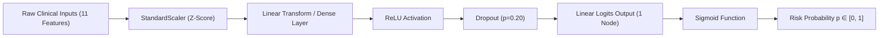

# Heart Failure Mortality Risk Predictor — Clinical Model Card
## Research Model Card: Arch B ($11 \to 16 \to 1$) & Logistic Regression Baseline

**Date:** November 25, 2026  
**Document Version:** 1.0 (Phase 5 Final Research Release)  
**Authors:** Antigravity AI Clinical Machine Learning & Diagnostic Systems Group  
**Standard Compliance:** Model Cards for Model Reporting (Mitchell et al., 2019)  

---

> [!CAUTION]
> **REGULATORY & CLINICAL BOUNDARY STATEMENT:**  
> The models described in this Model Card are **educational research prototypes**. They have **NOT** been cleared, approved, or CE-marked as Software as a Medical Device (SaMD) by the US FDA, EMA, or any national health authority. They are strictly prohibited from being used to direct clinical triage, determine therapeutic interventions, modify drug prescriptions, or replace bedside medical judgment.

---

## 1. Model Details

### 1.1 Basic Information
- **Model Name:** Heart Failure Mortality Risk Predictor — Candidate Arch B (with Logistic Regression Benchmark).
- **Model Version:** Release 1.0 (Post-Phase 5 Optimization).
- **Model Type:** Supervised Binary Classification / Probabilistic Risk Estimation.
- **Architectures Documented:**
  1. **Primary Neural Candidate (Arch B):** Multi-Layer Perceptron (MLP) with single hidden layer ($11 \to 16 \to 1$), ReLU activation, Dropout ($p=0.20$), and L2 Weight Decay ($\lambda = 0.01$).
  2. **Reference Benchmark (Logistic Regression):** Linear model ($11 \to 1$) with L2 regularization ($C=1.0$).
- **Frameworks:** PyTorch 2.6.0+cu124, Scikit-Learn 1.9.1, NumPy 2.2.6, Python 3.13.

### 1.2 Intended Use
- **Primary Intended Purpose:** Educational demonstration, academic research, and clinical data science evaluation of machine learning calibration and threshold behavior in cardiovascular datasets.
- **User Population:** Clinical data scientists, biostatisticians, and computer science students studying predictive modeling constraints on small clinical cohorts.
- **Out-of-Scope Applications:**
  - Real-time emergency department triage.
  - Guiding medication dosing or titration (e.g., ACE inhibitors, beta-blockers, diuretics).
  - Outpatient survival prognostication without physician oversight.
  - Application to pediatric patients, pregnant women, or non-heart-failure cardiology cohorts.

---

## 2. Dataset & Cohort Characterization

### 2.1 Dataset Source
- **Originating Institution:** Faisalabad Institute of Cardiology and Allied Hospital, Faisalabad, Pakistan.
- **Collection Window:** April 2015 – December 2015.
- **Primary Publication:** Ahmad, T., Munir, A., Bhatti, S. H., Aftab, M., & Raza, M. A. (2017). *"Survival analysis of heart failure patients: a case study."* PLoS ONE, 12(7), e0181001.
- **Open-Science Distribution:** Chicco, D., & Jurman, G. (2020). *"Machine learning can predict survival of patients with heart failure from serum creatinine and ejection fraction alone."* BMC Medical Informatics and Decision Making, 20(1), 16.

### 2.2 Sample Size & Class Distribution
- **Total Patient Records:** $N = 299$ adult patients.
- **Deceased During Follow-Up (`DEATH_EVENT` = 1):** $96$ patients ($32.11\%$).
- **Surviving During Follow-Up (`DEATH_EVENT` = 0):** $203$ patients ($67.89\%$).
- **Imbalance Ratio:** $2.11 : 1$ (Moderate class imbalance).
- **Patient Cohort Demographics:**
  - Age: Range 40 to 95 years (Mean $60.8 \pm 11.9$ years).
  - Sex: $194$ Male ($64.88\%$), $105$ Female ($35.12\%$).
  - Clinical Severity: All patients diagnosed with NYHA Class III or IV heart failure (severe left ventricular systolic dysfunction).

---

## 3. Clinical Feature Definitions & Harmonization

The model accepts exactly **11 input features** collected at baseline clinical presentation:

| Feature Name | Clinical Description | Data Type | Measurement Units | Typical Biological Range | Normal Clinical Reference |
| :--- | :--- | :--- | :--- | :--- | :--- |
| `age` | Chronological age of patient | Integer | Years | $40\text{--}95$ | N/A |
| `anaemia` | Hemoglobin deficiency flag | Binary | $0 = \text{No}, 1 = \text{Yes}$ | $0\text{ or }1$ | Hgb $\ge 12\text{ g/dL}$ (F), $\ge 13\text{ g/dL}$ (M) |
| `creatinine_phosphokinase` | Serum CPK / CK enzyme | Continuous | $\mu\text{g/L}$ (or $\text{U/L}$) | $23\text{--}7,861$ | $10\text{--}120\text{ mcg/L}$ |
| `diabetes` | History of diabetes mellitus | Binary | $0 = \text{No}, 1 = \text{Yes}$ | $0\text{ or }1$ | Fasting glucose $< 100\text{ mg/dL}$ |
| `ejection_fraction` | Percentage of blood leaving LV | Continuous | $\%$ | $14\text{--}80$ | Normal: $55\%\text{--}70\%$; Reduced: $<40\%$ |
| `high_blood_pressure` | Pre-existing hypertension | Binary | $0 = \text{No}, 1 = \text{Yes}$ | $0\text{ or }1$ | $\text{SBP} < 120\text{ mmHg}, \text{DBP} < 80\text{ mmHg}$ |
| `platelets` | Circulating blood platelets | Continuous | $\text{kiloplatelets}/\text{mL}$ | $25.01\text{--}850.0$ | $150\text{--}450\text{ kiloplatelets/mL}$ |
| `serum_creatinine` | Biomarker of renal clearance | Continuous | $\text{mg/dL}$ | $0.5\text{--}9.4$ | $0.6\text{--}1.2\text{ mg/dL}$ |
| `serum_sodium` | Circulating electrolyte level | Continuous | $\text{mEq/L}$ | $113\text{--}148$ | $135\text{--}145\text{ mEq/L}$ |
| `sex` | Biological sex | Binary | $0 = \text{Female}, 1 = \text{Male}$ | $0\text{ or }1$ | N/A |
| `smoking` | Current tobacco smoker | Binary | $0 = \text{No}, 1 = \text{Yes}$ | $0\text{ or }1$ | Non-smoker |

### Target Definition:
- **Variable Name:** `DEATH_EVENT`.
- **Definition:** All-cause patient mortality occurring during the clinical observation period ($1 = \text{Deceased}, 0 = \text{Survived}$).
- **Excluded Feature:** `time` (follow-up duration in days, range 4 to 285 days). Follow-up time was **strictly excluded** from feature sets because it is measured post-baseline and constitutes target leakage in static binary classification.

---

## 4. Preprocessing & Validation Pipeline

### 4.1 Feature Normalization
- All continuous and binary features are standardized to zero mean and unit variance ($z = \frac{x - \mu}{\sigma}$) using `StandardScaler`.
- **Strict Leakage Prevention:** The scaler's mean ($\mu$) and standard deviation ($\sigma$) are fitted **strictly on the training split** of each cross-validation fold. Validation and test folds are transformed using frozen parameters.

### 4.2 Cross-Validation Protocol
- **Partition Method:** Stratified 5-Fold Cross-Validation (`StratifiedKFold(n_splits=5, shuffle=True, random_state=42)`).
- **Outer Test Isolation:** Each outer test fold ($N \approx 60$) is isolated.
- **Nested Inner Partition:** Inside each outer training fold ($N \approx 239$), a stratified $80/20$ split ($N \approx 191$ inner-train, $N \approx 48$ inner-stop) is generated using `random_state = 42 + fold`.
  - Inner-stop is used exclusively for early-stopping patience tracking and threshold selection.
  - Models are refitted on the full outer training split ($N=239$) for the exact step budget determined during inner training before predicting on the untouched outer test fold.

---

## 5. Quantitative Performance Benchmarks

Performance metrics established across the 5 outer test folds:

| Metric | Logistic Regression (Baseline) | Arch B ($11 \to 16 \to 1$) | Arch C ($11 \to 32 \to 16 \to 1$) |
| :--- | :---: | :---: | :---: |
| **AUROC (Discrimination)** | **$77.1713\% \pm 5.5057\%$** | $76.1093\% \pm 6.2052\%$ | $74.8718\% \pm 6.9942\%$ |
| **Brier Score (Calibration)** | **$0.177731 \pm 0.028047$** | $0.180407 \pm 0.022975$ | $0.185912 \pm 0.029851$ |
| **Log Loss (Cross-Entropy)** | $0.543667 \pm 0.079001$ | **$0.541536 \pm 0.058847$** | $0.567540 \pm 0.087012$ |
| **Fixed Threshold ($\theta = 0.50$)** | | | |
| - Sensitivity | $48.11\% \pm 12.00\%$ | $42.84\% \pm 12.40\%$ | $47.11\% \pm 18.24\%$ |
| - Specificity | **$88.67\% \pm 6.15\%$** | $88.18\% \pm 7.41\%$ | $86.18\% \pm 5.70\%$ |
| - F1 Score | **$0.5576 \pm 0.1263$** | $0.5089 \pm 0.1332$ | $0.5258 \pm 0.1774$ |
| **Fixed Threshold ($\theta = 0.33$)** | | | |
| - Sensitivity | $64.84\% \pm 15.97\%$ | **$69.00\% \pm 15.06\%$** | $67.95\% \pm 16.14\%$ |
| - Specificity | $71.48\% \pm 4.45\%$ | **$71.50\% \pm 7.18\%$** | $69.41\% \pm 8.21\%$ |
| - F1 Score | $0.5693 \pm 0.1014$ | **$0.5959 \pm 0.0788$** | $0.5732 \pm 0.0912$ |
| **Inner Youden J Threshold ($\theta \approx 0.334$)** | | | |
| - Sensitivity | $63.79\% \pm 19.74\%$ | **$71.95\% \pm 3.88\%$** | $73.95\% \pm 6.47\%$ |
| - Specificity | $69.91\% \pm 18.00\%$ | **$69.98\% \pm 3.77\%$** | $65.54\% \pm 16.83\%$ |
| - F1 Score | $0.5593 \pm 0.0956$ | **$0.6110 \pm 0.0232$** | $0.6085 \pm 0.0839$ |

---

## 6. Decision Threshold Assessment

1. **Failure of Default Threshold ($\theta = 0.50$):**
   - In an imbalanced mortality cohort ($\pi \approx 32.1\%$), a $0.50$ threshold yields severe clinical under-diagnosis, missing more than half of dying patients ($42.84\%\text{--}48.11\%$ sensitivity, averaging $10.0\text{--}11.0$ false negatives per fold).
2. **Prevalence-Aligned Fixed Threshold ($\theta = 0.33$):**
   - Setting a fixed threshold near the natural event prevalence ($\theta = 0.33$) captures $69.00\%$ of mortality events (halving false negatives to $6.0$ per fold) while preserving $71.50\%$ specificity.
3. **Threshold Nomenclature Warning:**
   - Heuristic thresholds (Youden J or F1-max) are **unweighted empirical optimization points**. They must **never** be labeled as "clinically validated" or "medically approved".

---

## 7. Limitations & Sources of Bias

1. **Small Single-Center Cohort ($N = 299$):**
   - All data originates from a single tertiary cardiology center in Faisalabad, Pakistan. The sample size is limited, restricting statistical power for complex sub-group analyses.
2. **Spectrum Bias:**
   - The cohort consists exclusively of patients with severe symptomatic heart failure (NYHA Class III and IV). The models cannot be assumed to perform reliably on asymptomatic or mild heart failure populations (NYHA Class I and II).
3. **Absence of Longitudinal Biomarkers:**
   - Baseline measurements do not account for dynamic trajectory shifts in biomarkers (e.g., rapid worsening of serum creatinine or fluctuating sodium).
4. **Target Censoring Simplification:**
   - Modeling `DEATH_EVENT` as a binary static target disregards censoring and differential follow-up time (ranging from 4 to 285 days).
5. **Absence of True External Validation:**
   - **External validation has not yet been performed.** The models have never been evaluated on patient data outside the Faisalabad cohort. Generalizability across different hospital workflows, ethnic groups, or laboratory equipment remains unverified.

---

## 8. Clinical Governance & Intended-Use Restrictions

- **Research & Educational Software:** This software is published solely for machine learning research, educational coursework, and algorithm benchmarking.
- **No Diagnostic Reliance:** Physicians, nurses, and allied health staff must not make clinical decisions, alter treatment protocols, or counsel patients based on the outputs of this software.
