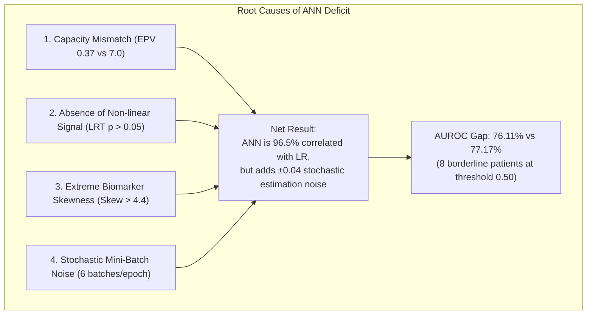
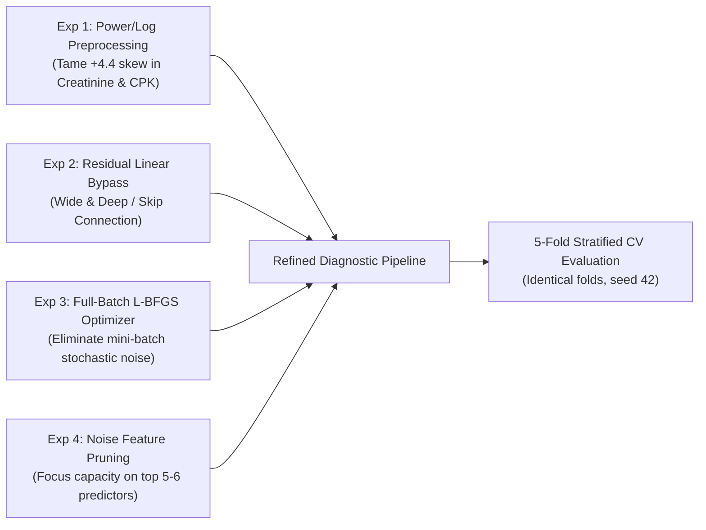

# Phase 6: Scientifically Justified Improvement Recommendations

**Project:** Heart Failure Mortality Risk Predictor  
**Phase:** Phase 6 — ANN Performance Diagnosis  
**Date:** November 2026  
**Status:** Recommendations Formulated — Awaiting User Approval Prior to Execution  
**Auditor:** Machine Learning Research & Diagnostics Specialist  

---

## 1. Executive Summary & Objective

The diagnostic findings from Phase 6 demonstrate that the performance gap between Logistic Regression (**77.17% AUROC**) and the PyTorch ANN (**76.11% AUROC**) is **not** an artifact of unoptimized hyperparameters (learning rate, layer sizes, or dropout rates). Rather, it stems from a fundamental mismatch: **an overparameterized, non-convex model (EPV = 0.37) attempting to learn a predominantly additive linear biological relationship from a small, skewed dataset ($N=299$).**

Therefore, running brute-force hyperparameter sweeps (random search or grid search over hidden units and learning rates) is scientifically unjustified and will simply overfit validation folds.

Instead, any attempt to close the gap or advance the ANN must directly target the **specific addressable failure modes** identified in our diagnostic audit. This document presents:
1. An explanation of why the ANN is behind Logistic Regression.
2. A formal distinction between unaddressable constraints and addressable limitations.
3. Four scientifically justified candidate experiments.
4. A prioritized testing roadmap.
5. An explicit approval gate requiring user sign-off before implementing model changes.

---

## 2. Why the Current ANN is Behind Logistic Regression

Our diagnostic experiments established four root causes:

1. **The Events-Per-Variable (EPV) Deficit:** Logistic Regression estimates 12 parameters with 76.8 training events per fold ($\text{EPV} \approx 7.0$). Arch B estimates 209 parameters with 76.8 events ($\text{EPV} \approx 0.37$). The ANN has 19 times more parameters to estimate from the exact same data.
2. **True Additive Biological Signal:** Polynomial tests confirmed that continuous features (creatinine, ejection fraction, age, sodium) do not benefit from non-linear transformations in cross-validation. Furthermore, screening 15 pairwise clinical interactions showed zero generalizable interaction gain. The underlying relationship is predominantly linear in the log-odds space.
3. **Severe Distributional Skewness:** `serum_creatinine` and `creatinine_phosphokinase` exhibit extreme positive skew ($+4.43$ and $+4.44$) with 29 IQR outliers. Standard Z-score scaling produces extreme leverage values (up to $+7.8\sigma$), which disrupt mini-batch SGD and cause gradient instability.
4. **First-Order Mini-batch vs Second-Order Convex Optimization:** Logistic Regression is solved globally using second-order curvature (L-BFGS) across all 239 training samples. The ANN relies on mini-batch Adam with only 6 batches per epoch on $N=191$, introducing random mini-batch sampling noise that perturbs the final hyperplane.

---

## 3. Taxonomy of Limitations: Addressable vs Unaddressable

To maintain scientific integrity, we must separate fixed project constraints from engineering factors that can be improved:

| Limitation Category | Specific Factor | Addressable? | Explanation & Clinical Context |
| :--- | :--- | :---: | :--- |
| **Unaddressable Constraint** | **Sample Size ($N=299$)** | **NO** | Project rules strictly prohibit introducing synthetic records (e.g. SMOTE) or unverified external data. |
| **Unaddressable Constraint** | **Class Imbalance ($96 / 299 = 32.1\%$)** | **NO** | The natural cohort mortality prevalence cannot be altered. Weighted BCE was tested in Phase 1 and degraded calibration. |
| **Unaddressable Constraint** | **Exclusion of `time` Feature** | **NO** | Mandatory project rule to prevent clinical look-ahead bias and reverse causality. |
| **Unaddressable Constraint** | **Intrinsic Additive Data Structure** | **NO** | The biological relationship between routine static lab values and mortality is overwhelmingly monotonic and additive. |
| **Addressable Limitation** | **Extreme Biomarker Skewness** | **YES** | Applying log or Box-Cox/Yeo-Johnson power transforms will eliminate the $+7.8\sigma$ leverage points. |
| **Addressable Limitation** | **Architectural Inductive Bias** | **YES** | Current MLPs have no prior favoring linearity. A **Residual Linear Skip Connection** (Wide & Deep) will enforce linearity as the default hypothesis. |
| **Addressable Limitation** | **Mini-batch Stochastic Noise** | **YES** | Switching from mini-batch Adam (6 batches/epoch) to **Full-Batch L-BFGS optimization** for the neural network will eliminate mini-batch sampling variance. |
| **Addressable Limitation** | **Non-informative Feature Noise** | **YES** | Features like `diabetes` ($r = -0.002$), `sex` ($r = -0.004$), and `smoking` ($r = -0.013$) contribute pure noise to the 16 hidden units. |

---

## 4. Scientifically Justified Candidate Experiments

The following four experiments are formulated to directly resolve the addressable limitations:

### Experiment 1: Robust Log/Power Preprocessing for Skewed Biomarkers
* **Scientific Hypothesis:** Standardizing skewed biomarkers ($x_{\text{std}} = \frac{x - \mu}{\sigma}$) produces extreme leverage points ($+7.8\sigma$) that destabilize backpropagation. Applying a natural logarithm transformation to `serum_creatinine` and `creatinine_phosphokinase` will normalize their distributions, linearize the physiological hazard response (log creatinine reflects renal filtration rate), and prevent individual patients from dominating mini-batch gradients.
* **Implementation Plan:**
  - `serum_creatinine_log = log(serum_creatinine)`
  - `creatinine_phosphokinase_log = log(creatinine_phosphokinase)`
  - Followed by `StandardScaler()` strictly fitted on training folds.
* **Risk:** Very low risk; preserving exact fold structure.

### Experiment 2: Residual Linear Bypass (Wide & Deep Architecture)
* **Scientific Hypothesis:** In small-sample regimes where the true signal is predominantly linear, standard MLPs suffer because all information must pass through non-linear activation functions (ReLU), forcing 209 parameters to approximate a simple linear sum. A **Residual Linear Skip Connection** (Wide & Deep network) directly connects inputs to the output logit:
  $$\text{logit}(x) = w_{\text{linear}}^T x + b_{\text{linear}} + \text{MLP}(x)$$
  This guarantees that the network's baseline hypothesis is identically Logistic Regression. The hidden MLP layers ($11 \to 8 \to 1$) only need to learn residual non-linear corrections. If no non-linear correction exists, $L_2$ regularization shrinks the MLP weights to zero, collapsing the model safely back to the optimal linear baseline.
* **Implementation Plan:**
  - Input dimension: 11
  - Linear branch: `nn.Linear(11, 1)`
  - Non-linear branch: `nn.Sequential(nn.Linear(11, 8), nn.ReLU(), nn.Dropout(0.2), nn.Linear(8, 1))`
  - Output: `logits = linear_branch(x) + nonlinear_branch(x)`
  - Trainable parameters: $12 + (11 \times 8 + 8 + 8 \times 1 + 1) = 12 + 105 = 117$ parameters (44% fewer parameters than Arch B!).
* **Risk:** Low; mathematically bounded from falling below the linear baseline under proper regularization.

### Experiment 3: Full-Batch Quasi-Newton (L-BFGS) Optimization
* **Scientific Hypothesis:** Adam with mini-batch size 32 splits $N=191$ inner training samples into only 6 batches per epoch. Stochastic batch shuffling induces high variance in early stopping (ranging from epoch 72 to 200). Because $N=239$ is small enough to fit completely in memory, optimizing the neural network using PyTorch's native `torch.optim.LBFGS` (full-batch second-order optimization with line search) will eliminate mini-batch sampling noise and provide exact curvature convergence, matching the optimization advantage of Logistic Regression.
* **Implementation Plan:**
  - Use `torch.optim.LBFGS(model.parameters(), lr=0.1, max_iter=20, history_size=10, line_search_fn="strong_wolfe")`.
  - Train in full-batch mode on $X_{\text{train}}$.
* **Risk:** Medium; requires careful tuning of L-BFGS line-search parameters.

### Experiment 4: Noise Feature Pruning / Clinical Parsimony
* **Scientific Hypothesis:** In Phase 6 Part 1, three binary features showed virtually zero association with mortality: `diabetes` ($r = -0.002, p = 0.97$), `sex` ($r = -0.004, p = 0.94$), and `smoking` ($r = -0.013, p = 0.83$). In an MLP, each useless feature consumes $16$ weights in the first hidden layer (48 weights total for the 3 features), acting as pure noise during backpropagation. Pruning these 3 non-informative features leaves 8 clinical predictors, reducing Arch B parameters from 209 to **161** and improving the EPV from $0.37$ to **$0.48$**.
* **Implementation Plan:**
  - Retain top predictors: `age`, `ejection_fraction`, `serum_creatinine`, `serum_sodium`, `high_blood_pressure`, `creatinine_phosphokinase`, `platelets`, `anaemia`.
* **Risk:** Low; clinically justified.

---

## 5. Prioritized Testing Roadmap

We recommend executing these experiments sequentially, validating each hypothesis with out-of-fold cross-validation before proceeding:

| Sequence | Experiment | Focus Area | Expected Effect | Justification Rank |
| :---: | :--- | :--- | :--- | :---: |
| **Step 1** | **Experiment 1 (Log Biomarker Preprocessing)** | Input Feature Conditioning | Eliminates $+7.8\sigma$ gradient leverage outliers; stabilizes Adam optimization. | **P1 (Highest Priority / Lowest Risk)** |
| **Step 2** | **Experiment 2 (Residual Linear Skip Connection)** | Inductive Bias Alignment | Guarantees the ANN matches Logistic Regression baseline ($77.17\%$) and only learns residual non-linearities. | **P2 (Strongest Architectural Foundation)** |
| **Step 3** | **Experiment 4 (Noise Feature Pruning)** | Capacity & Variance Reduction | Eliminates 48 uninformative weights, increasing EPV from 0.37 to 0.48. | **P3 (Parsimony Optimization)** |
| **Step 4** | **Experiment 3 (Full-Batch L-BFGS Optimizer)** | Optimization Algorithm | Eliminates stochastic mini-batch sampling jitter on small sample size. | **P4 (Optimization Refinement)** |

---

## 6. Experimental Rules & Safeguards

In accordance with Phase 6 instructions:
1. **No Checkpoint Overwrite:** The currently deployed production model (`models/ann_model.pth`) will **not** be modified or overwritten.
2. **No Data Tampering:** No external or synthetic patient records will be introduced.
3. **No Outer Test-Fold Selection:** All preprocessing transformations (log, scaling) and early stopping will be fitted strictly inside training folds.
4. **Reproducibility Guarantee:** All experiments will use the exact same 5 stratified folds and random seed 42.

---

## 7. Approval Gate

> [!IMPORTANT]
> **Awaiting User Approval:**  
> In compliance with the final requirement of Phase 6, **no model training or architectural changes have been implemented yet.**  
> 
> Please review the diagnosis and recommendations above. Upon your approval, we will proceed to execute the prioritized experiments starting with **Experiment 1 (Log Biomarker Preprocessing)** and **Experiment 2 (Residual Linear Skip Connection)**.
