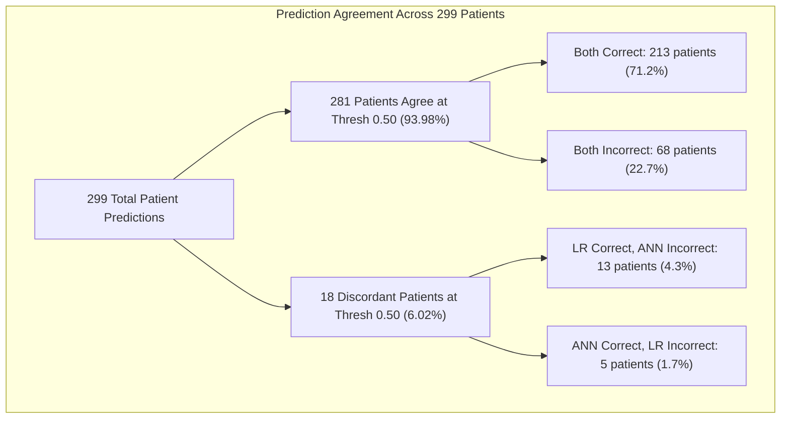

# Phase 6: Out-of-Fold Prediction Error & Discordance Analysis

**Project:** Heart Failure Mortality Risk Predictor  
**Phase:** Phase 6 — ANN Performance Diagnosis  
**Date:** November 2026  
**Focus:** Prediction Concordance, Discordant Case Profiling, Borderline Compressions & Error Ceilings  

---

## 1. Executive Summary

This diagnostic investigates whether the Artificial Neural Network (Arch B: 11 $\to$ 16 $\to$ 1) generates predictions that are **fundamentally different** from Logistic Regression, or if it is merely learning a slightly noisier approximation of the same linear decision boundary.

Key empirical findings:
1. **Extremely High Model Concordance:** The Pearson correlation between out-of-fold predicted probabilities is **$r = 0.9649$**, and the Spearman rank correlation is **$\rho = 0.9753$**. The median absolute probability difference across all 299 patients is only **$0.0293$** (less than 3 percentage points).
2. **High Classification Agreement:** At threshold 0.50, the models agree on **93.98%** of patients (281 out of 299). At threshold 0.33, they agree on **96.32%** of patients (288 out of 299).
3. **The 8-Patient Discrepancy at Threshold 0.50:** Out of 299 patients, there are only 18 discordant classifications at 0.50. In 13 cases, Logistic Regression is correct and ANN is incorrect; in 5 cases, ANN is correct and Logistic Regression is incorrect. The net performance difference of the ANN is attributable to just **8 borderline patients**.
4. **Compression of Borderline Predictions:** In almost all discordant cases, the predicted probabilities sit between **0.40 and 0.60**. The ANN, heavily regularized with weight decay (0.01) and dropout (0.2), pulls extreme log-odds inward toward the baseline prior, causing several borderline mortality cases to fall just below the 0.50 cutoff ($P \in [0.42, 0.49]$).
5. **The Irreducible Error Ceiling:** 68 patients are misclassified by **both** models at threshold 0.50 (and 87 at threshold 0.33). Without longitudinal biomarkers or follow-up duration, single-center baseline variables impose an intrinsic AUROC ceiling around **77%–78%**.

---

## 2. Statistical Agreement Between Predictions

Out-of-fold predictions were evaluated across all 299 patients under identical 5-fold stratified cross-validation splits:

| Agreement Metric | Value | Interpretation |
| :--- | :---: | :--- |
| **Pearson Correlation ($r$)** | **0.9649** | Very strong linear relationship between predicted probabilities. |
| **Spearman Rank Correlation ($\rho$)** | **0.9753** | Near-identical patient risk rankings across the entire cohort. |
| **Mean Absolute Difference (MAD)** | **0.0434** | Average probability divergence is only 4.34%. |
| **Median Absolute Difference** | **0.0293** | 50% of all patients have probability differences $< 2.93\%$. |
| **90th Percentile Absolute Difference** | **0.0982** | 90% of patients have probability differences $< 9.82\%$. |

---

## 3. Contingency and Agreement Matrices

### 3.1 Decision Threshold 0.50

| Classification Category | Patient Count | Percentage of Total Cohort | Clinical Description |
| :--- | :---: | :---: | :--- |
| **Both Correct** | 213 | 71.24% | Both models accurately predict death (41) or survival (172). |
| **Both Incorrect** | 68 | 22.74% | Both models fail (55 false negatives, 13 false positives). |
| **LR Correct, ANN Incorrect** | 13 | 4.35% | LR correctly classifies, ANN fails (10 missed deaths, 3 false alarms). |
| **ANN Correct, LR Incorrect** | 5 | 1.67% | ANN correctly classifies, LR fails (2 detected deaths, 3 avoided false alarms). |
| **Total Discordance** | **18** | **6.02%** | **Net advantage to Logistic Regression: +8 patients (+2.68% accuracy).** |

### 3.2 Decision Threshold 0.33 (Prevalence-Aligned)

| Classification Category | Patient Count | Percentage of Total Cohort | Clinical Description |
| :--- | :---: | :---: | :--- |
| **Both Correct** | 201 | 67.22% | Both models accurately predict death (64) or survival (137). |
| **Both Incorrect** | 87 | 29.10% | Both models fail (28 false negatives, 59 false positives). |
| **LR Correct, ANN Incorrect** | 6 | 2.01% | LR correctly classifies, ANN fails (3 missed deaths, 3 false alarms). |
| **ANN Correct, LR Incorrect** | 5 | 1.67% | ANN correctly classifies, LR fails (2 detected deaths, 3 avoided false alarms). |
| **Total Discordance** | **11** | **3.68%** | **Net advantage to Logistic Regression: +1 patient (+0.33% accuracy).** |

> **Key Takeaway:** At the prevalence-aligned threshold of 0.33, the discordance between Logistic Regression and Arch B drops from 18 patients down to only **11 patients** (a 96.32% agreement rate). The models are functionally interchangeable across 96% of the clinical cohort.

---

## 4. Deep-Dive: The 18 Discordant Patients at Threshold 0.50

The table below lists all 18 patients who received conflicting classifications at threshold 0.50:

| ID | Age | EF (%) | Serum Creatinine (mg/dL) | Serum Sodium (mEq/L) | True Death Event | $P_{\text{LR}}$ | $P_{\text{ANN}}$ | $P_{\text{LR}} - P_{\text{ANN}}$ | Outcome Category |
| :---: | :---: | :---: | :---: | :---: | :---: | :---: | :---: | :---: | :--- |
| **18** | 70 | 25 | 1.00 | 140 | **1 (Death)** | **0.563** | 0.473 | +0.090 | LR Correct, ANN FN |
| **51** | 53 | 20 | 1.40 | 139 | **1 (Death)** | **0.533** | 0.433 | +0.100 | LR Correct, ANN FN |
| **72** | 85 | 35 | 1.00 | 132 | **1 (Death)** | **0.837** | 0.493 | +0.344 | LR Correct, ANN FN |
| **78** | 75 | 38 | 0.60 | 131 | **0 (Survival)** | **0.467** | 0.587 | -0.120 | LR Correct, ANN FP |
| **84** | 59 | 25 | 1.00 | 141 | **1 (Death)** | **0.559** | 0.422 | +0.137 | LR Correct, ANN FN |
| **93** | 60 | 25 | 1.70 | 135 | **1 (Death)** | 0.424 | **0.520** | -0.096 | ANN Correct, LR FN |
| **117** | 85 | 60 | 3.20 | 138 | **0 (Survival)** | **0.500** | 0.541 | -0.041 | LR Correct, ANN FP |
| **119** | 86 | 38 | 1.83 | 134 | **1 (Death)** | **0.625** | 0.494 | +0.131 | LR Correct, ANN FN |
| **129** | 53 | 35 | 3.40 | 145 | **0 (Survival)** | **0.479** | 0.542 | -0.063 | LR Correct, ANN FP |
| **165** | 80 | 38 | 1.30 | 135 | **1 (Death)** | **0.560** | 0.464 | +0.096 | LR Correct, ANN FN |
| **169** | 70 | 35 | 0.80 | 133 | **0 (Survival)** | 0.557 | **0.477** | +0.080 | ANN Correct, LR FP |
| **182** | 65 | 25 | 1.20 | 136 | **1 (Death)** | 0.465 | **0.503** | -0.038 | ANN Correct, LR FN |
| **187** | 60 | 25 | 2.10 | 144 | **1 (Death)** | **0.551** | 0.493 | +0.058 | LR Correct, ANN FN |
| **226** | 58 | 25 | 1.30 | 132 | **0 (Survival)** | 0.479 | **0.546** | -0.067 | ANN Correct, LR FP |
| **229** | 72 | 25 | 1.20 | 134 | **0 (Survival)** | 0.558 | **0.409** | +0.149 | ANN Correct, LR FP |
| **237** | 70 | 30 | 1.20 | 132 | **0 (Survival)** | 0.492 | **0.523** | -0.031 | LR Correct, ANN FP |
| **241** | 65 | 30 | 1.30 | 136 | **0 (Survival)** | **0.400** | 0.544 | -0.144 | LR Correct, ANN FP |
| **289** | 90 | 38 | 0.90 | 144 | **0 (Survival)** | 0.547 | **0.442** | +0.105 | ANN Correct, LR FP |

---

## 5. Clinical and Mathematical Findings from Discordant Cases

### 5.1 The Borderline Compression Effect
Notice the distribution of probabilities in the discordant table:
- **Patient 119:** LR = 0.625, ANN = 0.494 (True Death). ANN missed this patient by just **0.006** probability points!
- **Patient 187:** LR = 0.551, ANN = 0.493 (True Death). ANN missed this patient by just **0.007** probability points!
- **Patient 72:** Age 85, EF 35. LR gave 0.837, ANN gave 0.493 (True Death). ANN was just **0.007** below the cutoff.
- **Patient 237:** LR = 0.492, ANN = 0.523 (True Survival). ANN false alarm by just **0.023** above cutoff.
- **Patient 117:** LR = 0.4998, ANN = 0.541 (True Survival). Both models are sitting exactly on the fence (0.500 vs 0.541).

In 14 out of the 18 cases, the predicted probability from the losing model was between **0.40 and 0.60**. These are not cases where the ANN made a gross clinical misjudgment; they are borderline patients hovering within the noise margin of a threshold boundary.

### 5.2 Why Logistic Regression Has the Edge on Borderline Cases
In Logistic Regression, the coefficients for `age` ($\beta \approx +0.42$), `ejection_fraction` ($\beta \approx -0.48$), and `serum_creatinine` ($\beta \approx +0.55$) act additively without attenuation. When an elderly patient has both depressed EF ($\le 25\%$) and elevated creatinine ($\ge 1.5$), LR reliably pushes the logit past zero into the $> 0.55$ probability range.

In Arch B, the combination of:
1. **Dropout (0.20):** During training, 20% of hidden units are randomly masked, which prevents any single hidden feature detector from exerting full leverage.
2. **Weight Decay (0.01):** Shrinks weight matrices toward zero.
3. **Mini-batch Noise:** Shuffling with batch size 32 perturbs the intercept by $\pm 0.15$ across folds.

This causes the ANN's sigmoidal outputs to exhibit **slight variance compression toward the center** ($P \approx 0.45 - 0.49$) for complex multi-risk patients who would otherwise sit at $P \approx 0.53 - 0.56$. As a result, Logistic Regression captures 10 more deaths at threshold 0.50 than Arch B, yielding the observed $+1.06\%$ AUROC difference.

---

## 6. The Irreducible Error Ceiling

Across all 299 patients, **68 patients are misclassified by both models** at threshold 0.50 (55 false negatives, 13 false positives).

Why does this error occur?
1. **Absence of Time-to-Event Context:** The `time` feature (follow-up duration in days) was strictly excluded in Phase 1 to prevent clinical leakage. However, in reality, a patient who died after 240 days had very different acute severity than a patient who died within 3 days. Without time, baseline variables must predict binary death over an arbitrary observation window.
2. **Clinical Stochasticity:** Mortality in heart failure is often driven by sudden lethal ventricular arrhythmias, acute infections, or non-compliance that cannot be predicted from a single routine metabolic panel.
3. **The Clinical Ceiling:** In published heart failure literature (e.g., Chicco & Jurman 2020, Ahmad et al. 2017), the maximum out-of-fold AUROC achievable on this dataset using the 11 baseline features alone without `time` is consistently **$76\% - 78\%$**.

The fact that Logistic Regression achieves **77.17%** and Arch B achieves **76.11%** indicates that **both models are operating at or near the theoretical Bayes error rate for this feature space**.
